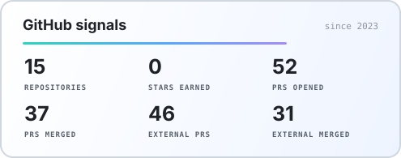
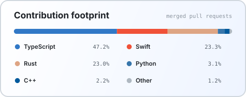

<div align="center">

<a href="https://ghfind.com/u/puppyben1?ref=badge"></a>

<p>
  <a href="https://github.com/puppyben1"></a>
  <a href="mailto:13323021675@163.com"></a>
  <a href="https://github.com/puppyben1?tab=repositories"></a>
</p>

**广东药科大学 · 28届 · 电子信息**<br />

</div>

## `01 / ABOUT`

```text
role      电子信息专业学生
focus     Java 后端 · Python · AI 应用开发
learning  Rust · 操作系统 · Agent Runtime
goal      在真实项目与开源协作中持续打磨工程能力
```

## `02 / TOOLBOX`

<p align="center">
  
</p>

## `03 / GITHUB SIGNALS`

<div align="center">




</div>

---

<div align="center">
  <sub>Profile cards are generated automatically by GitHub Actions.</sub>
</div>
